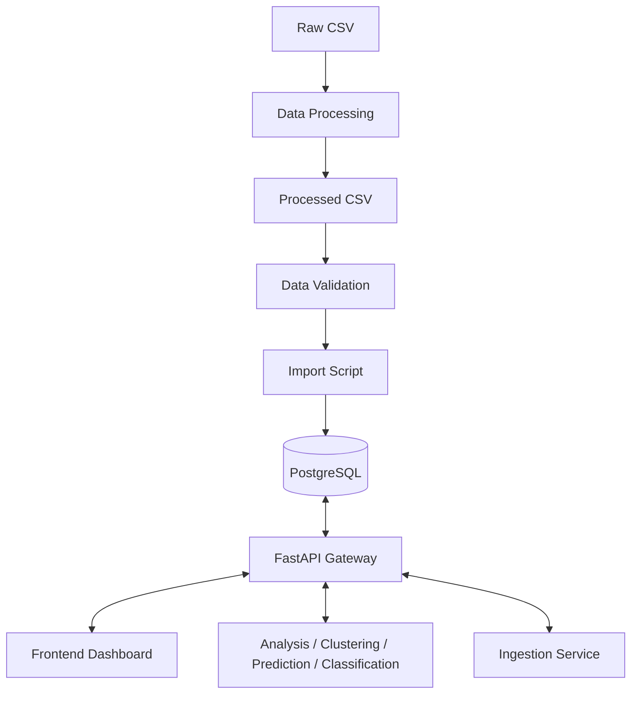
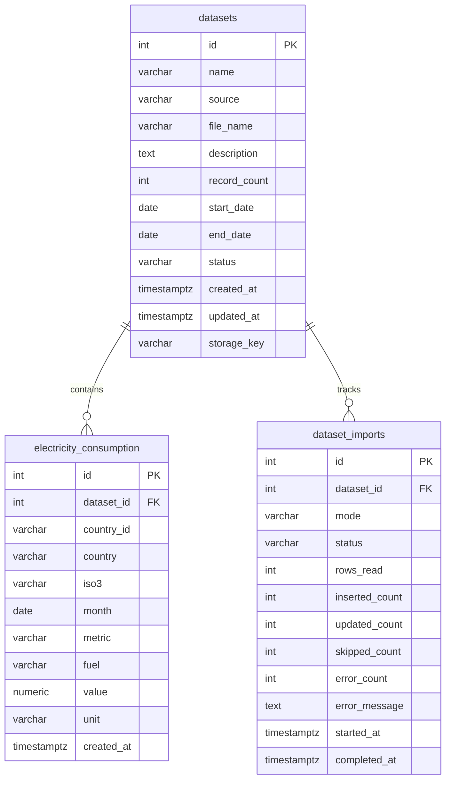

# DATABASE DESIGN

## 1. Database Overview

- Project: Electricity Consumption Analytics
- DBMS: PostgreSQL 16 Alpine
- Database: electricity_analytics_db
- Schema: public
- ORM: SQLAlchemy
- Migration tool: Alembic
- Migration revision: 20261124_0002 (head)
- Deployment: Docker Compose
- Verification date: 2026-11-24

Database được sử dụng để lưu trữ, quản lý và cung cấp
dữ liệu phục vụ thống kê, phân tích xu hướng,
phân cụm và dự báo nhu cầu điện tại Việt Nam.

## 2. Database Architecture



Gateway quản lý kết nối PostgreSQL thông qua SQLAlchemy và DATABASE_URL. Các microservice xử lý nghiệp vụ riêng; Gateway quản lý giao dịch database, metadata và lịch sử import.

Demand API sử dụng `load_demand_from_db()` để truy vấn PostgreSQL, lọc VNM, demand, fuel IS NULL và TWh, sắp xếp theo tháng và hỗ trợ phân trang. Nguồn dữ liệu đã được xác nhận qua API thực tế. Sơ đồ mô tả kiến trúc hệ thống; chỉ luồng CSV – PostgreSQL – Demand API đã được nghiệm thu trong phạm vi Data.

API đăng nhập qua POST `/api/auth/login`, sử dụng JWT trong HttpOnly Cookie. Demand API yêu cầu tài khoản Admin hoặc Analyst. Secret được cấu hình cục bộ trong `.env`.

## 3. Database Tables

| Table | Description |
|---|---|
| datasets | Quản lý metadata của bộ dữ liệu |
| electricity_consumption | Lưu nhu cầu điện theo tháng |
| dataset_imports | Quản lý lịch sử import dataset |
| model_runs | Quản lý lần chạy mô hình |
| users | Quản lý người dùng |
| alembic_version | Quản lý phiên bản migration |

Phạm vi tài liệu này tập trung vào datasets
electricity_consumption và dataset_imports.

## 4. Entity Relationship Diagram



## 5. Table Design

### 5.1. Table: datasets

Quản lý thông tin tổng quan của mỗi bộ dữ liệu.

| Column | Data Type | Nullable | Default |
|---|---|---|---|
| id | INTEGER | No | Auto increment |
| name | VARCHAR(160) | No | - |
| source | VARCHAR(255) | No | - |
| file_name | VARCHAR(255) | No | - |
| description | TEXT | Yes | - |
| record_count | INTEGER | No | 0 |
| start_date | DATE | Yes | - |
| end_date | DATE | Yes | - |
| status | VARCHAR(30) | No | ready |
| created_at | TIMESTAMPTZ | No | now() |
| updated_at | TIMESTAMPTZ | No | now() |
| storage_key | VARCHAR(80) | Yes | - |

Constraints:

- Primary key: id
- Unique constraint: uq_datasets_name_source
- Unique fields: name, source
- Unique constraint: uq_datasets_storage_key (storage_key)
- storage_key cho phép NULL đối với dataset đã tồn tại.

### 5.2. Table: electricity_consumption

Lưu trữ dữ liệu nhu cầu điện theo từng tháng.

| Column | Data Type | Nullable | Default |
|---|---|---|---|
| id | INTEGER | No | Auto increment |
| dataset_id | INTEGER | No | - |
| country_id | VARCHAR(80) | No | - |
| country | VARCHAR(120) | No | - |
| iso3 | VARCHAR(3) | No | - |
| month | DATE | No | - |
| metric | VARCHAR(80) | No | - |
| fuel | VARCHAR(80) | Yes | - |
| value | NUMERIC(14,4) | No | - |
| unit | VARCHAR(30) | No | - |
| created_at | TIMESTAMPTZ | No | now() |

Constraints:

- Primary key: id
- Foreign key: dataset_id
- References: datasets(id)
- Delete behavior: ON DELETE CASCADE
- Check constraint: ck_electricity_value_nonnegative
- Check expression: value >= 0

### 5.3. Table: dataset_imports

| Column | Data Type | Nullable | Default |
|---|---|---|---|
| id | INTEGER | No | Auto increment |
| dataset_id | INTEGER | No | - |
| mode | VARCHAR(20) | No | - |
| status | VARCHAR(20) | No | - |
| rows_read | INTEGER | No | 0 |
| inserted_count | INTEGER | No | 0 |
| updated_count | INTEGER | No | 0 |
| skipped_count | INTEGER | No | 0 |
| error_count | INTEGER | No | 0 |
| error_message | TEXT | Yes | - |
| started_at | TIMESTAMPTZ | No | now() |
| completed_at | TIMESTAMPTZ | Yes | - |

Primary key: id. Foreign key: dataset_id REFERENCES datasets(id) ON DELETE CASCADE.

## 6. Table Relationships

| Parent | Child | Relationship | Foreign key |
|---|---|---|---|
| datasets | electricity_consumption | 1:N | dataset_id |
| datasets | dataset_imports | 1:N | dataset_id |

Cả hai khóa ngoại sử dụng ON DELETE CASCADE. Mỗi bản ghi nhu cầu điện hoặc lịch sử import phải thuộc một dataset.

## 7. Indexes and Constraints

### 7.1. Table: datasets

| Index | Type | Columns |
|---|---|---|
| datasets_pkey | Primary Key | id |
| uq_datasets_name_source | Unique | name, source |
| uq_datasets_storage_key | Unique | storage_key |

### 7.2. Table: electricity_consumption

| Index | Type | Columns |
|---|---|---|
| electricity_consumption_pkey | Primary Key | id |
| ix_electricity_country_month | B-tree | country_id, month |
| ix_electricity_metric_month | B-tree | metric, month |
| ix_electricity_month | B-tree | month |
| uq_electricity_natural_key | Unique | country_id, month, metric, COALESCE(fuel, '') |

Các index hỗ trợ truy vấn theo quốc gia,
chỉ số điện và khoảng thời gian.

Unique index ngăn chặn các bản ghi trùng khóa tự nhiên.

COALESCE(fuel, '') giúp xử lý trường hợp fuel
có giá trị NULL khi kiểm tra tính duy nhất.

### 7.3. Table: dataset_imports

| Index | Type | Columns |
|---|---|---|
| dataset_imports_pkey | Primary Key | id |
| ix_dataset_imports_dataset_id | B-tree | dataset_id |
| ix_dataset_imports_started_at | B-tree | started_at |

## 8. Database Configuration

| Parameter | Value |
|---|---|
| Docker image | postgres:16-alpine |
| Container | electricity-analytics-postgres |
| Host | 127.0.0.1 |
| Host port | 5433 |
| Container port | 5432 |
| Docker internal host | postgres |
| Database | electricity_analytics_db |
| Username | electricity_app |
| Password | Configured in .env |
| Volume | electricity_analytics_postgres_data |

Không commit file .env chứa thông tin đăng nhập.

## 9. Migration Management

Migration directory:

BE/alembic/versions/

| Revision | File | Changes |
|---|---|---|
| 20261122_0001 | 20261122_0001_initial_schema.py | Initial schema |
| 20261124_0002 | 20261124_0002_dataset_import_history.py | storage_key và dataset_imports |

Đã sao lưu database bằng pg_dump trước khi nâng cấp. Chưa kiểm thử phục hồi bản sao lưu. Migration 0002 không tự tạo lịch sử cho các lần import trước đó; 93 bản ghi vẫn được giữ nguyên.

Apply migrations:

```powershell
alembic upgrade head
```

Check current migration:

```powershell
alembic current
```

Verified revision:

20261124_0002 (head)

Không chỉnh sửa migration đã được áp dụng.
Các thay đổi schema cần được quản lý bằng
migration mới và thống nhất với Backend.

## 10. Data Ingestion

Processed dataset:

data/processed/vietnam_electricity_demand.csv

Import script:

BE/scripts/import_electricity_data.py

Import command:

```powershell
python .\scripts\import_electricity_data.py
```

Quy trình:

1. Đọc file processed CSV.
2. Kiểm tra schema và dữ liệu.
3. Chuẩn hóa kiểu dữ liệu.
4. Tạo hoặc cập nhật metadata dataset.
5. Kiểm tra bản ghi trùng.
6. Ghi dữ liệu vào PostgreSQL.

Backend mới hỗ trợ upload, import và sync qua API. Ingestion Service xử lý đọc và chuẩn hóa dữ liệu; Gateway quản lý metadata, upsert và lịch sử import. Các chức năng API này chưa được kiểm thử trong phạm vi hiện tại.

## 11. Database Validation

Verification date: 2026-11-24

| Validation | Actual Result | Status |
|---|---|---|
| PostgreSQL container | Healthy | PASS |
| Migration revision | 20261124_0002 (head) | PASS |
| Database tables | 6 | PASS |
| dataset_imports schema | Verified | PASS |
| datasets.storage_key | Verified | PASS |
| Records after migration | 93 | PASS |
| CSV rows validated | 93 | PASS |
| Records inserted | 93 | PASS |
| Duplicates skipped - first import | 0 | PASS |
| Dataset metadata count | 1 | PASS |
| Dataset status | imported | PASS |
| Consumption record count | 93 | PASS |
| First five records comparison | Matched | PASS |
| Primary keys | Configured | PASS |
| Foreign key | Configured | PASS |
| Unique index | Configured | PASS |
| Nonnegative value constraint | Configured | PASS |
| Re-import validation | 0 inserted, 93 duplicates skipped | PASS |
| Backend startup | Application startup complete | PASS |
| Swagger UI | Accessible | PASS |
| Health Check API | HTTP 200, status success | PASS |
| Electricity Demand API | HTTP 200, 93 records | PASS |
| API country | Vietnam | PASS |
| API ISO3 | VNM | PASS |
| API unit | TWh | PASS |
| API start month | 2019-01 | PASS |
| API end month | 2026-09 | PASS |
| CSV vs API | 93 records matched | PASS |
| CSV vs PostgreSQL | 93 records matched | PASS |
| API vs PostgreSQL | 93 records matched | PASS |
| Data consistency validation | All three data sources matched | PASS |
| API data source verification | PostgreSQL: electricity_consumption | PASS |
| PostgreSQL integration | Verified | PASS |
| API login and auth/me | HTTP 200 | PASS |
| Health readiness | HTTP 200, database connected | PASS |
| Pagination (multiple pages) | 93 records, page_size 30 | PASS |

Kết quả import và re-import được ghi nhận trước migration 0002.

### Record count verification

```sql
SELECT COUNT(*)
FROM electricity_consumption;
```

Actual result: 93

### Sample data verification

```sql
SELECT country, month, metric, value, unit
FROM electricity_consumption
ORDER BY month
LIMIT 5;
```

| country | month | metric | value | unit |
|---|---|---|---|---|
| Vietnam | 2019-01-01 | demand | 17.8700 | TWh |
| Vietnam | 2019-02-01 | demand | 18.8900 | TWh |
| Vietnam | 2019-03-01 | demand | 16.1100 | TWh |
| Vietnam | 2019-04-01 | demand | 20.0000 | TWh |
| Vietnam | 2019-05-01 | demand | 20.8600 | TWh |

### Data consistency verification

Verification date: 2026-11-24

Validation script:

BE/validate_api_data.py

Execution command (from BE directory):

```powershell
python validate_api_data.py
```

Preconditions:

- PostgreSQL container is running.
- Database migration and data import are completed.
- FastAPI Gateway is running on port 8000.
- Tài khoản local hợp lệ; nhập email và mật khẩu khi script yêu cầu.

Validation sources:

- Processed CSV
- PostgreSQL electricity_consumption table
- GET /api/electricity/demand

Actual results:

| Data source | Record count |
|---|---|
| Processed CSV | 93 |
| PostgreSQL | 93 |
| Electricity Demand API | 93 |

| Comparison | Result |
|---|---|
| CSV vs API | PASS |
| CSV vs PostgreSQL | PASS |
| API vs PostgreSQL | PASS |
| API source validation | PASS |
| API metadata validation | PASS |
| Record count validation | PASS |
| Duplicate month validation | PASS |
| Missing value validation | PASS |
| Month range validation | PASS |
| Pagination validation (4 pages, page_size=30) | PASS |

Conclusion:

- Multi-page pagination validation: PASS
- Page size: 30
- Expected number of pages: 4
- Total retrieved records: 93
- Overall validation result: PASS
- Validation exit code: 0

Toàn bộ 93 bản ghi giữa CSV, PostgreSQL và API
có giá trị month và value thống nhất sau khi chuẩn hóa.

API cung cấp dữ liệu từ 2019-01 đến 2026-09.

Data consistency validation: PASS.

API source: `PostgreSQL: electricity_consumption`.

PostgreSQL integration: Verified. Toàn bộ 93 cặp month-value khớp sau khi chuẩn hóa đến 4 chữ số thập phân.

## 12. Data Persistence

PostgreSQL sử dụng Docker Volume:

electricity_analytics_postgres_data

Dữ liệu được giữ lại khi container dừng
hoặc được tạo lại nếu volume vẫn tồn tại.

Không sử dụng docker compose down -v
khi cần giữ lại dữ liệu database.

## 13. Current Limitations

- Database được triển khai cục bộ.
- Dataset chỉ chứa dữ liệu Việt Nam theo tháng, gồm 93 quan sát.
- Không có dữ liệu theo tỉnh thành, hộ gia đình, ngày hoặc giờ.
- Script validation sử dụng số lượng và khoảng thời gian kỳ vọng của dataset hiện tại.
- Chưa kiểm thử chức năng upload, sync và ghi lịch sử import qua API.
- Chưa kiểm thử phục hồi backup.
- Frontend và các microservice phân tích, dự báo, phân cụm, phân loại nằm ngoài phạm vi nghiệm thu Data hiện tại.
- Thiết kế chi tiết users và model_runs nằm ngoài phạm vi tài liệu Data.
- Schema được mô tả theo migration 20261124_0002.

## 14. Related Documents

- [Data Dictionary](data-dictionary.md)
- [API Documentation](api-documentation.md)
- [System Architecture](architecture.md)
- [Service Architecture](service-architecture.md)
- [Algorithms](algorithms.md)
