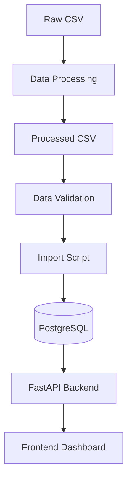
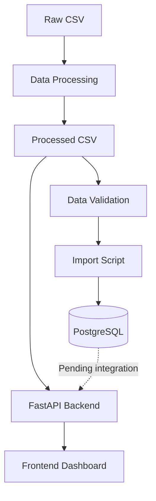
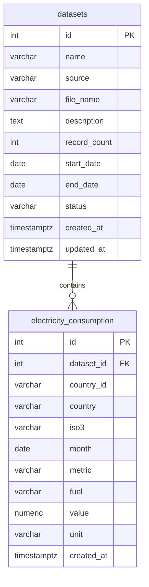

# DATABASE DESIGN

## 1. Database Overview

- Project: Electricity Consumption Analytics
- DBMS: PostgreSQL 16 Alpine
- Database: electricity_analytics_db
- Schema: public
- ORM: SQLAlchemy
- Migration tool: Alembic
- Migration revision: 20261122_0001
- Deployment: Docker Compose
- Verification date: 2026-11-24

Database được sử dụng để lưu trữ, quản lý và cung cấp
dữ liệu phục vụ thống kê, phân tích xu hướng,
phân cụm và dự báo nhu cầu điện tại Việt Nam.

## 2. Database Architecture



Sơ đồ trên mô tả kiến trúc mục tiêu của hệ thống.

PostgreSQL được triển khai trong Docker Container.
Backend được thiết kế để kết nối với database thông qua
SQLAlchemy và DATABASE_URL được cấu hình trong file .env.

Hiện tại, PostgreSQL đã được khởi tạo và import thành công
93 bản ghi. Electricity Demand API đã trả về dữ liệu
khớp với CSV và PostgreSQL.

Qua kiểm tra BE/app/services/electricity.py,
hàm load_demand() hiện đọc trực tiếp file processed CSV
thông qua csv.DictReader().

PostgreSQL đã sẵn sàng cung cấp dữ liệu cho Backend.
Tuy nhiên, Electricity Demand API chưa sử dụng
PostgreSQL làm nguồn truy xuất dữ liệu.

Việc tích hợp truy vấn PostgreSQL cần được
thực hiện trong giai đoạn tiếp theo.

### Current Data Architecture



## 3. Database Tables

| Table | Description |
|---|---|
| datasets | Quản lý metadata của bộ dữ liệu |
| electricity_consumption | Lưu nhu cầu điện theo tháng |
| model_runs | Quản lý lần chạy mô hình - vai trò dự kiến |
| users | Quản lý người dùng - vai trò dự kiến |
| alembic_version | Quản lý phiên bản migration |

Phạm vi tài liệu này tập trung vào datasets
và electricity_consumption.

## 4. Entity Relationship Diagram



## 5. Table Design

### 5.1. Table: datasets

Quản lý thông tin tổng quan của mỗi bộ dữ liệu.

| Column | Data Type | Nullable | Default |
|---|---|---|---|
| id | INTEGER | No | Auto increment |
| name | VARCHAR(160) | No | - |
| source | VARCHAR(255) | No | - |
| file_name | VARCHAR(255) | No | - |
| description | TEXT | Yes | - |
| record_count | INTEGER | No | 0 |
| start_date | DATE | Yes | - |
| end_date | DATE | Yes | - |
| status | VARCHAR(30) | No | ready |
| created_at | TIMESTAMPTZ | No | now() |
| updated_at | TIMESTAMPTZ | No | now() |

Constraints:

- Primary key: id
- Unique constraint: uq_datasets_name_source
- Unique fields: name, source

### 5.2. Table: electricity_consumption

Lưu trữ dữ liệu nhu cầu điện theo từng tháng.

| Column | Data Type | Nullable | Default |
|---|---|---|---|
| id | INTEGER | No | Auto increment |
| dataset_id | INTEGER | No | - |
| country_id | VARCHAR(80) | No | - |
| country | VARCHAR(120) | No | - |
| iso3 | VARCHAR(3) | No | - |
| month | DATE | No | - |
| metric | VARCHAR(80) | No | - |
| fuel | VARCHAR(80) | Yes | - |
| value | NUMERIC(14,4) | No | - |
| unit | VARCHAR(30) | No | - |
| created_at | TIMESTAMPTZ | No | now() |

Constraints:

- Primary key: id
- Foreign key: dataset_id
- References: datasets(id)
- Delete behavior: ON DELETE CASCADE
- Check constraint: ck_electricity_value_nonnegative
- Check expression: value >= 0

## 6. Table Relationships

Relationship: One-to-Many (1:N)

datasets.id -> electricity_consumption.dataset_id

Một dataset có thể chứa nhiều bản ghi nhu cầu điện.

Mỗi bản ghi nhu cầu điện phải thuộc một dataset.

ON DELETE CASCADE đảm bảo các bản ghi liên quan
bị xóa khi dataset tương ứng bị xóa.

## 7. Indexes and Constraints

### 7.1. Table: datasets

| Index | Type | Columns |
|---|---|---|
| datasets_pkey | Primary Key | id |
| uq_datasets_name_source | Unique | name, source |

### 7.2. Table: electricity_consumption

| Index | Type | Columns |
|---|---|---|
| electricity_consumption_pkey | Primary Key | id |
| ix_electricity_country_month | B-tree | country_id, month |
| ix_electricity_metric_month | B-tree | metric, month |
| ix_electricity_month | B-tree | month |
| uq_electricity_natural_key | Unique | country_id, month, metric, COALESCE(fuel, '') |

Các index hỗ trợ truy vấn theo quốc gia,
chỉ số điện và khoảng thời gian.

Unique index ngăn chặn các bản ghi trùng khóa tự nhiên.

COALESCE(fuel, '') giúp xử lý trường hợp fuel
có giá trị NULL khi kiểm tra tính duy nhất.

## 8. Database Configuration

| Parameter | Value |
|---|---|
| Docker image | postgres:16-alpine |
| Container | electricity-analytics-postgres |
| Host | 127.0.0.1 |
| Host port | 5433 |
| Container port | 5432 |
| Database | electricity_analytics_db |
| Username | electricity_app |
| Password | Configured in .env |
| Volume | electricity_analytics_postgres_data |

Không commit file .env chứa thông tin đăng nhập.

## 9. Migration Management

Migration directory:

BE/alembic/versions/

Initial migration:

20261122_0001_initial_schema.py

Apply migrations:

```powershell
alembic upgrade head
```

Check current migration:

```powershell
alembic current
```

Verified revision:

20261122_0001 (head)

Không chỉnh sửa migration đã được áp dụng.
Các thay đổi schema cần được quản lý bằng
migration mới và thống nhất với Backend.

## 10. Data Ingestion

Processed dataset:

data/processed/vietnam_electricity_demand.csv

Import script:

BE/scripts/import_electricity_data.py

Import command:

```powershell
python .\scripts\import_electricity_data.py
```

Quy trình:

1. Đọc file processed CSV.
2. Kiểm tra schema và dữ liệu.
3. Chuẩn hóa kiểu dữ liệu.
4. Tạo hoặc cập nhật metadata dataset.
5. Kiểm tra bản ghi trùng.
6. Ghi dữ liệu vào PostgreSQL.

## 11. Database Validation

Verification date: 2026-11-24

| Validation | Actual Result | Status |
|---|---|---|
| PostgreSQL container | Healthy | PASS |
| Migration revision | 20261122_0001 | PASS |
| CSV rows validated | 93 | PASS |
| Records inserted | 93 | PASS |
| Duplicates skipped - first import | 0 | PASS |
| Dataset metadata count | 1 | PASS |
| Dataset status | imported | PASS |
| Consumption record count | 93 | PASS |
| First five records comparison | Matched | PASS |
| Primary keys | Configured | PASS |
| Foreign key | Configured | PASS |
| Unique index | Configured | PASS |
| Nonnegative value constraint | Configured | PASS |
| Re-import validation | 0 inserted, 93 duplicates skipped | PASS |
| Backend startup | Application startup complete | PASS |
| Swagger UI | Accessible | PASS |
| Health Check API | HTTP 200, status success | PASS |
| Electricity Demand API | HTTP 200, 93 records | PASS |
| API country | Vietnam | PASS |
| API ISO3 | VNM | PASS |
| API unit | TWh | PASS |
| API start month | 2019-01 | PASS |
| API end month | 2026-09 | PASS |
| CSV vs API | 93 records matched | PASS |
| CSV vs PostgreSQL | 93 records matched | PASS |
| API vs PostgreSQL | 93 records matched | PASS |
| Data consistency validation | All three data sources matched | PASS |
| API data source verification | Direct CSV access confirmed in electricity.py | PASS |
| PostgreSQL integration | Demand service currently reads CSV instead of PostgreSQL | Pending |

### Record count verification

```sql
SELECT COUNT(*)
FROM electricity_consumption;
```

Actual result: 93

### Sample data verification

```sql
SELECT country, month, metric, value, unit
FROM electricity_consumption
ORDER BY month
LIMIT 5;
```

| country | month | metric | value | unit |
|---|---|---|---|---|
| Vietnam | 2019-01-01 | demand | 17.8700 | TWh |
| Vietnam | 2019-02-01 | demand | 18.8900 | TWh |
| Vietnam | 2019-03-01 | demand | 16.1100 | TWh |
| Vietnam | 2019-04-01 | demand | 20.0000 | TWh |
| Vietnam | 2019-05-01 | demand | 20.8600 | TWh |

### Data consistency verification

Verification date: 2026-11-24

Validation script:

BE/validate_api_data.py

Execution command (from BE directory):

```powershell
python validate_api_data.py
```

Preconditions:

- PostgreSQL container is running.
- Database migration and data import are completed.
- FastAPI Backend is running on port 8000.

Validation sources:

- Processed CSV
- PostgreSQL electricity_consumption table
- GET /api/electricity/demand

Actual results:

| Data source | Record count |
|---|---|
| Processed CSV | 93 |
| PostgreSQL | 93 |
| Electricity Demand API | 93 |

| Comparison | Result |
|---|---|
| CSV vs API | PASS |
| CSV vs PostgreSQL | PASS |
| API vs PostgreSQL | PASS |

Conclusion:

Toàn bộ 93 bản ghi giữa CSV, PostgreSQL và API
có giá trị month và value thống nhất sau khi chuẩn hóa.

API cung cấp dữ liệu từ 2019-01 đến 2026-09.

Data consistency validation: PASS.

API source:

data/processed/vietnam_electricity_demand.csv

Kết quả kiểm tra tính nhất quán không đồng nghĩa
với việc Backend đang truy vấn trực tiếp PostgreSQL.

API data source verification: Completed.

The load_demand() function currently reads
the processed CSV directly using csv.DictReader().

PostgreSQL integration: Pending implementation.

## 12. Data Persistence

PostgreSQL sử dụng Docker Volume:

electricity_analytics_postgres_data

Dữ liệu được giữ lại khi container dừng
hoặc được tạo lại nếu volume vẫn tồn tại.

Không sử dụng docker compose down -v
khi cần giữ lại dữ liệu database.

## 13. Current Limitations

- Database hiện được triển khai cục bộ.
- Dataset chỉ chứa dữ liệu Việt Nam.
- Dữ liệu có độ phân giải theo tháng.
- Dataset có 93 quan sát.
- Không có dữ liệu theo tỉnh thành hoặc hộ gia đình.
- Không có dữ liệu theo ngày hoặc giờ.
- Electricity Demand service hiện đọc trực tiếp
  file processed CSV thông qua csv.DictReader().
- Chưa tích hợp truy vấn PostgreSQL vào Demand API.
- Cần phối hợp với Backend để chuyển nguồn truy xuất
  từ CSV sang PostgreSQL.
- Chưa nghiệm thu tích hợp toàn bộ Backend API.
- Thiết kế chi tiết users và model_runs nằm ngoài
  phạm vi tài liệu Data hiện tại.
- Schema được mô tả theo migration 20261122_0001.

## 14. Related Documents

- [Data Dictionary](data-dictionary.md)## 13. Current Limitations
- Database hiện được triển khai cục bộ.
- Dataset chỉ chứa dữ liệu Việt Nam.
- Dữ liệu có độ phân giải theo tháng.
- Dataset có 93 quan sát.
- Không có dữ liệu theo tỉnh thành hoặc hộ gia đình.
- Không có dữ liệu theo ngày hoặc giờ.
- Electricity Demand service hiện đọc trực tiếp
  file processed CSV thông qua csv.DictReader().
- Chưa tích hợp truy vấn PostgreSQL vào Demand API.
- Cần phối hợp với Backend để chuyển nguồn truy xuất
  từ CSV sang PostgreSQL.
- Chưa nghiệm thu tích hợp toàn bộ Backend API.
- Thiết kế chi tiết users và model_runs nằm ngoài
  phạm vi tài liệu Data hiện tại.
- Schema được mô tả theo migration 20261122_0001.## 13. Current Limitations

- Database hiện được triển khai cục bộ.
- Dataset chỉ chứa dữ liệu Việt Nam.
- Dữ liệu có độ phân giải theo tháng.
- Dataset có 93 quan sát.
- Không có dữ liệu theo tỉnh thành hoặc hộ gia đình.
- Không có dữ liệu theo ngày hoặc giờ.
- Electricity Demand service hiện đọc trực tiếp
  file processed CSV thông qua csv.DictReader().
- Chưa tích hợp truy vấn PostgreSQL vào Demand API.
- Cần phối hợp với Backend để chuyển nguồn truy xuất
  từ CSV sang PostgreSQL.
- Chưa nghiệm thu tích hợp toàn bộ Backend API.## 13. Current Limitations

- Database hiện được triển khai cục bộ.
- Dataset chỉ chứa dữ liệu Việt Nam.
- Dữ liệu có độ phân giải theo tháng.
- Dataset có 93 quan sát.
- Không có dữ liệu theo tỉnh thành hoặc hộ gia đình.
- Không có dữ liệu theo ngày hoặc giờ.
- Electricity Demand service hiện đọc trực tiếp
  file processed CSV thông qua csv.DictReader().
- Chưa tích hợp truy vấn PostgreSQL vào Demand API.
- Cần phối hợp với Backend để chuyển nguồn truy xuất
  từ CSV sang PostgreSQL.
- Chưa nghiệm thu tích hợp toàn bộ Backend API.
- Thiết kế chi tiết users và model_runs nằm ngoài
  phạm vi tài liệu Data hiện tại.
- Schema được mô tả theo migration 20261122_0001.
- Thiết kế chi tiết users và model_runs nằm ngoài
  phạm vi tài liệu Data hiện tại.
- Schema được mô tả theo migration 20261122_0001.## 13. Current Limitations

- Database hiện được triển khai cục bộ.
- Dataset chỉ chứa dữ liệu Việt Nam.
- Dữ liệu có độ phân giải theo tháng.
- Dataset có 93 quan sát.
- Không có dữ liệu theo tỉnh thành hoặc hộ gia đình.
- Không có dữ liệu theo ngày hoặc giờ.
- Electricity Demand service hiện đọc trực tiếp
  file processed CSV thông qua csv.DictReader().
- Chưa tích hợp truy vấn PostgreSQL vào Demand API.
- Cần phối hợp với Backend để chuyển nguồn truy xuất
  từ CSV sang PostgreSQL.
- Chưa nghiệm thu tích hợp toàn bộ Backend API.
- Thiết kế chi tiết users và model_runs nằm ngoài
  phạm vi tài liệu Data hiện tại.
- Schema được mô tả theo migration 20261122_0001.
- [API Documentation](api-documentation.md)
- [System Architecture](architecture.md)
- [Algorithms](algorithms.md)
